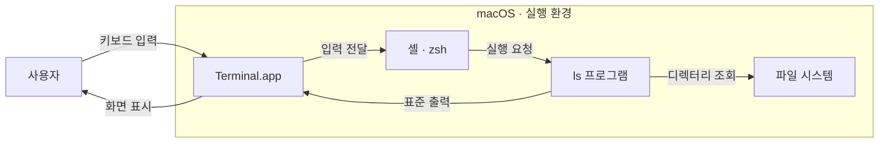

# 맥북 개발환경 학습 노트

> [!info] 관련 개념
> - [[#명령 실행 — 터미널에서 ls를 치면 누가 실행할까?]] → [[#패키지 관리 — brew는 어떻게 실행하고 무엇을 관리할까?]]
> - [[#설치 과정 — 같은 wget을 설치하는 두 가지 방법]] → [[#빌드 도구 — Xcode Command Line Tools는 언제 필요할까?]] → [[#꼬들 프로젝트 — 도구 설치와 프로젝트 빌드]]

[원본 ChatGPT 대화 — 맥북 개발환경 시작](chatgpt-conversation://6af5c87c-fb60-83ee-899b-0f7792f55772)

대화는 `brew`를 Python이나 Jupyter처럼 실행하는지, Homebrew와 Apple이 각각 무엇을 관리하는지 묻는 데서 시작했다. CLT가 꼭 필요한지 따져 보다가 같은 프로그램도 미리 빌드된 파일을 설치하거나 내 Mac에서 직접 빌드할 수 있다는 점으로 이어졌다. 여기서는 그 차이를 이해하는 데 필요한 명령 실행부터 살펴본다. 인용 블록에는 원본 대화에서 나온 질문을 해당 주제에 맞춰 배치했다.

## 명령 실행 — 터미널에서 ls를 치면 누가 실행할까?

Terminal.app을 열면 보통 기본 셸인 zsh가 시작되고, 명령을 받을 준비가 됐다는 프롬프트가 나타난다. `hello.py`와 `notes` 폴더가 있는 디렉터리에서 `ls`를 실행해 보자. [Apple의 기본 셸 안내](https://support.apple.com/guide/terminal/change-the-default-shell-trml113/mac)



1. **사용자**가 터미널 창에 `ls`를 입력하고 Return을 누른다. 명령이 끝나면 같은 창에서 결과를 확인한다.
2. **Terminal.app**이 키 입력을 받아 zsh에 전달한다. 사용자가 보는 창과 텍스트 입출력을 맡는 앱이다.
3. **zsh**가 입력을 해석한다. 기본 `ls`를 실행하는 상황이라면 셸이 실행 파일을 찾아 macOS에 실행을 요청한다. macOS에 포함된 `ls`의 경로는 `/bin/ls`다.
4. **`ls` 프로그램**은 경로 인자가 없으므로 현재 작업 디렉터리를 조회한다. macOS의 파일 시스템 기능으로 항목을 읽고 목록을 만든다.
5. **Terminal.app**이 `ls`의 표준 출력을 받아 화면에 표시한다. 사용자는 `hello.py`와 `notes`를 확인하고, `ls`가 종료되면 zsh 프롬프트가 다시 나타난다.

그림은 역할과 흐름을 보여 주는 개념도다. 실제로 **macOS**가 프로세스 실행과 메모리 관리를 맡고, 운영체제가 제공하는 터미널 연결을 통해 입력과 출력이 오간다. Terminal.app과 zsh는 그 위에서 동작하는 별개의 프로그램이다. 프론트엔드와 백엔드라는 비유는 화면과 명령 해석을 구별하는 데 쓸 수 있다. 기술적으로는 터미널 앱과 셸이 입출력으로 연결된 구조다. [Apple 명령줄 입출력 안내](https://developer.apple.com/library/archive/documentation/OpenSource/Conceptual/ShellScripting/CommandLInePrimer/CommandLine.html) · [zsh 명령 실행 문서](https://zsh.sourceforge.io/Doc/Release/Command-Execution.html)

### 셸이 직접 처리하는 명령과 외부 프로그램

`cd notes`는 zsh가 직접 처리하는 **내장 명령**이다. 현재 셸의 작업 디렉터리가 바뀌므로 이어서 `pwd`로 위치를 확인하거나 `ls`로 새 디렉터리의 목록을 볼 수 있다. `ls`와 `brew`는 일반적으로 **외부 프로그램**으로 실행된다. `type cd`, `type ls`, `type brew`를 실행하면 셸이 각 이름을 내장 명령, 외부 프로그램, 별칭 등 무엇으로 해석하는지 알 수 있다.

Python이 설치된 환경에서 `python3 hello.py`를 입력하면 zsh는 `python3`를 실행하고 `hello.py`를 인자로 건넨다. 파일의 코드를 읽고 실행하는 쪽은 Python이다. `python3`만 실행했을 때 나타나는 `>>>`에서는 Python이 입력을 처리하고, `exit()`로 나오면 다시 zsh가 입력을 받는다. 같은 터미널 창에서 입력을 처리하는 프로그램이 바뀌는 사례다. [Python 인터프리터 사용법](https://docs.python.org/3/tutorial/interpreter.html)

### PATH — 설치했는데 brew 명령을 못 찾는 이유

`PATH`는 셸이 외부 명령을 이름으로 찾을 때 살펴보는 디렉터리 목록이다. zsh는 앞에 있는 디렉터리부터 검색한다. macOS에서 목록의 각 경로는 콜론으로 구분되며, `/bin/ls`처럼 전체 경로를 입력하면 해당 실행 파일을 바로 지정할 수 있다.

```sh
printf '%s\n' "$PATH"
command -v brew
```

첫 번째 명령은 검색 경로를 보여 준다. 두 번째는 현재 셸이 `brew`를 어떻게 찾는지 보여 준다. Apple Silicon의 기본 설치 경로를 쓰면 보통 `/opt/homebrew/bin/brew`가 표시된다. 설치 후에도 `command not found: brew`가 나오면 실행 파일이 있는 디렉터리가 `PATH`에 들어 있는지 확인하고, 필요한 경우 설치 종료 시 안내된 `brew shellenv` 설정을 적용한다. [zsh의 PATH 설명](https://zsh.sourceforge.io/Doc/Release/Parameters.html) · [Homebrew 설치 후 설정](https://docs.brew.sh/Installation.html#post-installation-steps)

## 패키지 관리 — brew는 어떻게 실행하고 무엇을 관리할까?

> 그리고 홈브루라는 건 별도의 터미널? shell 같은 게 아니라  python, jupyter 명령어처럼 터미널에서 사용하는 명령어로 사용하는 거죠? 홈브루는 애플 공식인 건가요? 리눅스에서 apt 사용하는 것처럼?

`brew install wget`을 입력하면 zsh가 `brew`를 실행하고 `install`과 `wget`을 인자로 넘긴다. Homebrew는 이를 설치 요청으로 해석해 wget과 필요한 의존성을 설치한다. 설치 후 `wget --version`을 입력하면 zsh는 `wget`을 실행하고, wget이 자기 버전을 출력한다. 이후 `brew list --formula`로 설치된 Formula를 확인하고, `brew upgrade wget`과 `brew uninstall wget`으로 업데이트하거나 제거할 수 있다. [Homebrew 명령 설명서](https://docs.brew.sh/Manpage)

Homebrew는 macOS와 Linux에서 사용할 수 있는 독립 오픈소스 패키지 관리자다. Debian 계열의 `apt`와 설치·업데이트라는 역할이 비슷하다. `apt`는 Debian 계열의 시스템 패키지 관리 체계에 통합되어 있고, macOS에서는 Homebrew를 추가로 설치해 Homebrew가 관리하는 패키지에 사용한다. [Homebrew 공식 사이트](https://brew.sh/) · [Debian 패키지 관리 도구](https://www.debian.org/doc/manuals/debian-faq/pkgtools.en.html)

> 결국 기본 터미널 쉘인 zsh도 오픈소스, 패키지 관리자인 Homebrew도 오픈소스. 애플이 하는 건 없네요. 오히려 그래서 자유로워서 개발자들이 선호하는 건가.

Apple은 macOS와 Terminal.app을 제공하고, 오픈소스 zsh를 기본 셸로 채택해 함께 배포한다. Xcode Command Line Tools도 Apple이 배포한다. 개발자는 이 환경에 Homebrew 같은 도구를 추가할 수 있다. `ls`, `grep`, `ssh`처럼 Linux에서도 익숙한 명령을 쓸 수 있다는 점은 작업 방식을 옮기는 데 도움이 된다. 세부 옵션은 운영체제나 도구 버전에 따라 다를 수 있다. [Apple 터미널 사용 설명서](https://support.apple.com/guide/terminal/welcome/mac) · [Apple Command Line Tools 문서](https://developer.apple.com/documentation/xcode/installing-the-command-line-tools/)

| 역할 | macOS 환경의 예 | Windows 환경의 예 |
| --- | --- | --- |
| 운영체제 | macOS | Windows |
| 입출력 인터페이스 | Terminal.app | Windows Terminal |
| 명령 해석 | zsh | PowerShell |
| 패키지 검색·설치 | Homebrew의 `brew` | Windows Package Manager의 `winget` |

예를 들어 Windows Terminal의 PowerShell에서 `winget search Git`을 실행하면 PowerShell이 winget을 실행하고 winget이 패키지를 검색한다. Terminal.app의 zsh에서 `brew search git`을 실행할 때도 같은 역할 분담을 볼 수 있다. [Microsoft Windows Terminal 설명](https://learn.microsoft.com/en-us/windows/terminal/) · [Microsoft WinGet 설명](https://learn.microsoft.com/en-us/windows/package-manager/winget/)

## 설치 과정 — 같은 wget을 설치하는 두 가지 방법

> Homebrew가 프로그램을 설치한다고 했는데, 무슨 프로그램을 말하는 것이고 설치 방법 두 방식에 대해 좀 더 구체적으로 설명 및 예시를 들어주세요.

Git, JDK, Maven, Node.js 같은 개발 도구도 Homebrew로 설치하는 프로그램이다. 두 설치 방식은 파일을 내려받는 명령줄 도구 `wget` 하나로 비교해 볼 수 있다. Homebrew는 두 방식 모두 **wget Formula**를 읽는다. Formula는 소스 URL, 체크섬, 의존성, 빌드·설치 절차 등을 담을 수 있는 Ruby로 작성된 패키지 정의다. `brew info wget`으로 패키지 정보를 확인할 수 있다. [Formula Cookbook](https://docs.brew.sh/Formula-Cookbook) · [wget Formula](https://formulae.brew.sh/formula/wget)

| 비교 항목 | Bottle 설치 | 소스 빌드 |
| --- | --- | --- |
| 명령 | `brew install wget` | `brew install --build-from-source wget` |
| wget에 대해 받는 파일 | Homebrew에서 미리 빌드해 압축한 패키지 | wget의 소스 코드 |
| 빌드하는 곳 | 배포 전 Homebrew 빌드 환경 | 설치 중 내 Mac |
| 내 Mac에서 하는 일 | 내려받아 설치하므로 보통 더 빠르다. | 빌드 도구와 의존성을 준비해 컴파일하고 설치한다. |

보통 `brew install wget`은 현재 환경에 맞는 Bottle을 사용할 수 있으면 자동으로 선택한다. macOS 버전, CPU 아키텍처, 설치 경로가 호환 여부에 영향을 준다. 호환되는 Bottle이 없거나 직접 빌드해 테스트하고 싶을 때는 소스 빌드를 고려할 수 있다. `--build-from-source`는 wget 자체를 소스에서 빌드하라는 요청이며, 의존 패키지는 호환되는 Bottle로 설치될 수 있다. [Homebrew Bottle 문서](https://docs.brew.sh/Bottles) · [Homebrew 명령 설명서](https://docs.brew.sh/Manpage)

소스에서 wget을 빌드할 때는 소스와 라이브러리를 준비하고, Clang 같은 컴파일러로 C 코드를 목적 파일로 바꾼다. 링커가 목적 파일과 필요한 라이브러리를 연결해 실행 파일을 만들면, Homebrew가 결과물과 관련 파일을 설치 위치에 배치한다. `make`는 Makefile에 정의된 빌드 단계와 의존 관계를 처리할 때 쓰인다. 필요한 도구는 프로그램마다 다르다.

> 이러한 과정을 git이든, jdk든 maven이든 node.js든 직접  프로그램 bottle을 다운 받거나 소스코드로 빌드해서 만들거나 한다는 거죠?

맞다. Git, JDK, Maven, Node.js도 배포자가 미리 빌드한 파일을 설치하거나 각 프로젝트의 절차에 따라 소스에서 빌드할 수 있다. 예를 들어 Node.js 공식 설치 파일은 **바이너리 배포본**이고, **Bottle**은 그중 Homebrew가 Formula의 빌드 결과를 배포할 때 쓰는 이름이다. Maven 자체를 소스에서 빌드한다면 프로젝트가 요구하는 JDK가 필요하다. 직접 설치할 때는 다운로드와 설치, 이후 업데이트를 직접 챙기고, Homebrew를 쓰면 그 작업과 의존성 관리를 한 도구에서 처리할 수 있다.

## 빌드 도구 — Xcode Command Line Tools는 언제 필요할까?

> Homebrew를 쓰려면 반드시 Xcode Command Line Tools를 설치해야 하나요? 필요한 git, clang, make 같은 걸 수동으로 설치하면 안 되나요?

앞에서 본 두 설치 경로에 따라 답이 달라진다. Apple Silicon에서 호환되는 Bottle을 설치할 때는 CLT 없이 진행할 수 있다. macOS에서 Homebrew Formula를 소스 빌드할 때는 CLT 또는 전체 Xcode가 필요하다. Intel Mac에서 기존 호환 Bottle을 설치하는 경우에도 Homebrew 설치 문서는 Apple 개발 도구가 필요하다고 안내한다. [Homebrew 설치 요구 사항](https://docs.brew.sh/Installation.html#macos-requirements) · [Homebrew 플랫폼별 지원](https://docs.brew.sh/Support-Tiers)

Git은 소스와 이력을 관리하고, Clang은 컴파일하며, `make`는 정해진 빌드 단계를 실행한다. 세 도구를 따로 설치해 명령이 실행돼도 macOS용 빌드 환경이 갖춰졌는지는 별개다. 프로젝트에 따라 링커, macOS SDK의 헤더와 라이브러리 인터페이스, 외부 라이브러리, 올바른 도구 경로까지 필요하다. CLT는 Apple의 명령줄 도구 체인과 macOS SDK를 함께 제공한다. [Apple Command Line Tools 문서](https://developer.apple.com/documentation/xcode/installing-the-command-line-tools/)

> 그럼 홈브루가 Xcode Command Line Tools 패키지를 쓰기도 하지만, 반대로 홈브루가 Xcode Command Line Tools 패키지를 관리하기도 하나요?

Homebrew는 빌드 중에 Apple 개발 도구를 사용할 수 있다. CLT 설치와 업데이트는 Apple의 관리 범위다. `xcode-select --install`로 별도 CLT 패키지 설치를 요청할 수 있고, `xcode-select -p`는 현재 선택된 개발 도구 디렉터리를 표시한다. CLT 업데이트는 macOS 소프트웨어 업데이트에서 받고, Homebrew로 설치한 Node.js는 `brew upgrade node`로 업데이트한다. [Apple Command Line Tools 설치 및 업데이트](https://developer.apple.com/documentation/xcode/installing-the-command-line-tools/) · [Homebrew 명령 설명서](https://docs.brew.sh/Manpage)

## 꼬들 프로젝트 — 도구 설치와 프로젝트 빌드

| 개발 도구 | 꼬들 프로젝트에서 하는 일 |
| --- | --- |
| Git | 소스 코드의 변경 이력을 기록하고 공유한다. |
| JDK | Java 코드를 컴파일하고 Java 프로그램을 실행할 환경을 제공한다. |
| Maven | Java 프로젝트의 의존성을 관리하고 테스트와 패키징을 수행한다. |
| Node.js | 브라우저 밖에서 JavaScript를 실행해 프런트엔드 개발 도구를 구동할 수 있게 한다. |

```sh
brew install maven
mvn package
```

첫 번째 명령은 Homebrew로 **Maven이라는 도구를 설치**한다. 두 번째 명령은 `pom.xml`이 있는 디렉터리에서 Maven으로 **꼬들 프로젝트를 빌드하고 패키징**한다. JAR 프로젝트라면 기본 설정에서 보통 `target/`에 JAR 파일이 생성된다. [Maven 빌드 수명 주기](https://maven.apache.org/guides/introduction/introduction-to-the-lifecycle.html)

## 복습 질문

- `cd notes` 다음에 `ls`를 실행하면 어느 프로그램이 작업 디렉터리를 바꾸고, 어느 프로그램이 목록을 읽는가?
- Homebrew를 설치했는데 `brew`를 찾을 수 없다면 zsh에서 무엇을 확인할까?
- 같은 `wget`을 설치할 때 Formula는 두 방식에 어떻게 쓰이고, 실행 파일은 각각 어디에서 만들어지는가?
- CLT를 설치하거나 업데이트하는 도구, Maven을 설치하는 도구, 꼬들 프로젝트를 빌드하는 도구는 각각 무엇인가?
