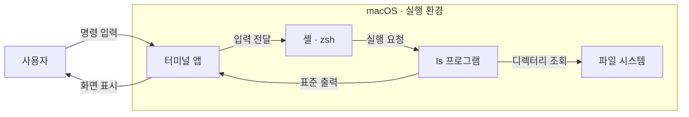

# 셸과 zsh

> [!info] 관련 개념
> - [[02 · Terminal.app|Terminal.app]] — 명령을 입력하고 결과를 보는 앱
> - [[01 · macOS|macOS]] — 터미널과 셸이 동작하는 운영체제
> - [[04 · PATH|PATH]] — 외부 명령의 위치 검색
> - [[01 · Homebrew|Homebrew]] — 셸에서 brew로 실행하는 프로그램

터미널 창을 열면 보통 zsh 프롬프트가 나타난다. 프롬프트는 셸이 명령을 입력받을 준비가 됐다는 표시다. zsh는 macOS 터미널의 기본 셸이며, 사용자가 입력한 명령을 대화형으로 처리하거나 스크립트에 적힌 명령을 실행할 수 있다. [Apple의 기본 셸 안내](https://support.apple.com/guide/terminal/change-the-default-shell-trml113/mac)

| 구성 요소 | 역할 |
| --- | --- |
| 사용자 | 명령을 입력하고 화면에 표시된 결과를 확인한다. |
| 터미널(Terminal.app) | 사용자와 셸 사이의 입출력 인터페이스다. 키보드 입력을 전달하고 프로그램의 출력을 화면에 표시한다. |
| 셸(Shell, 여기서는 zsh) | 입력을 해석하고 필요한 프로그램을 실행하는 명령어 해석기다. |
| macOS | 프로세스 실행, 파일 시스템 접근, 메모리 관리 등 프로그램이 동작하는 데 필요한 기능을 제공하는 운영체제다. |

Terminal.app과 zsh는 macOS 위에서 동작하는 별개의 프로그램이다. 터미널을 프론트엔드, 셸을 백엔드에 비유하면 화면을 다루는 쪽과 명령을 해석하는 쪽을 구별하기 쉽다. 이 비유는 역할을 설명하기 위한 것이며, 실제 구조는 같은 운영체제에서 터미널 앱과 셸이 입출력으로 연결된 형태다. Windows Terminal과 PowerShell도 각각 터미널 앱과 셸에 해당한다. [[01 · macOS#Windows 환경과 비교|Windows 환경과 역할별 비교]]

## `ls`를 입력하면

현재 작업 디렉터리에 `hello.py`와 `notes` 폴더가 있다고 가정해 보자.

그림은 구성 요소의 역할과 데이터 흐름을 보여 주는 개념도다. 실제로는 macOS가 프로세스를 실행하고, 운영체제가 제공하는 터미널 연결을 통해 입력과 출력이 오간다.

1. **사용자가 입력한다.** 터미널 창의 zsh 프롬프트에서 `ls`를 입력하고 Return 키를 누른다.
2. **터미널이 입력을 전달한다.** Terminal.app이 키 입력을 받아 macOS의 터미널 연결을 통해 zsh에 전달한다. Return 키 입력을 받으면 zsh가 입력한 줄을 처리한다.
3. **zsh가 명령을 해석하고 실행을 요청한다.** `ls`가 외부 명령으로 해석되는 일반적인 경우, zsh는 [[04 · PATH|PATH]]에서 실행 파일을 찾는다. macOS에 기본으로 포함된 실행 파일은 `/bin/ls`이며, zsh의 요청을 받아 macOS가 이를 별도 프로세스로 실행한다.
4. **`ls`가 디렉터리 내용을 조회한다.** 조회할 경로를 따로 지정하지 않았으므로 `ls`는 셸에서 이어받은 현재 작업 디렉터리를 대상으로 삼는다. macOS의 파일 시스템 기능을 이용해 항목을 읽고 표시할 목록을 만든다.
5. **터미널이 결과를 표시한다.** `ls`가 표준 출력에 쓴 목록은 macOS의 터미널 연결을 통해 Terminal.app에 도착한다. 사용자는 창에서 `hello.py`와 `notes`를 확인한다. `ls`가 종료되면 zsh가 다음 명령을 받을 프롬프트를 표시한다.

[Apple 명령줄 입출력과 `ls` 안내](https://developer.apple.com/library/archive/documentation/OpenSource/Conceptual/ShellScripting/CommandLInePrimer/CommandLine.html) · [zsh 명령 실행 문서](https://zsh.sourceforge.io/Doc/Release/Command-Execution.html)

## 셸 내장 명령과 외부 프로그램

**내장 명령**인 `cd notes`는 zsh가 직접 처리해 현재 셸의 작업 디렉터리를 바꾼다. 이어서 `ls`를 실행하면 바뀐 디렉터리의 목록이 나온다. `ls`와 `brew` 같은 **외부 명령**은 실행된 프로그램이 작업을 맡는다. `type cd`, `type ls`, `type brew`를 실행하면 현재 zsh가 각 이름을 내장 명령, 외부 프로그램, 별칭 등 무엇으로 해석하는지 확인할 수 있다. `brew`는 Homebrew가 설치되어 있고 셸에서 찾을 수 있을 때 외부 프로그램으로 표시된다.

## python을 실행하는 경우와 비교

Python이 `python3` 명령으로 설치되어 있고 현재 디렉터리에 `hello.py`가 있다고 가정해 보자.

| 입력한 명령 | 셸이 실행하는 프로그램 | 실행된 프로그램의 작업 |
| --- | --- | --- |
| `brew install wget` | brew | `install wget`을 해석해 wget을 설치한다. |
| `python3 hello.py` | Python 인터프리터 | `hello.py`의 Python 코드를 읽고 실행한다. |

두 경우 모두 zsh는 첫 단어를 실행할 프로그램 이름으로 해석하고, 뒤에 오는 `install`과 `wget` 또는 `hello.py`를 해당 프로그램에 인자로 전달한다. [Python 인터프리터 사용법](https://docs.python.org/3/tutorial/interpreter.html)

`python3`만 실행하면 Python의 대화형 프롬프트인 `>>>`가 나타난다. 이때 입력은 실행 중인 Python이 처리한다. `exit()`로 Python을 종료하면 다시 셸 프롬프트로 돌아온다. 터미널 창은 그대로여도 입력을 처리하는 프로그램이 바뀌는 사례다.
