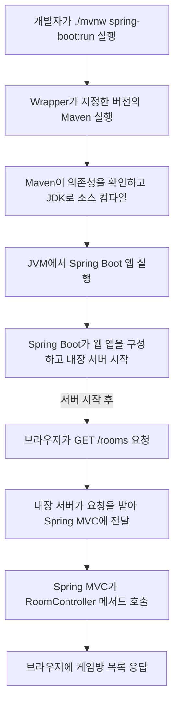

# 자바·스프링 개발 학습 노트

> [!info] 관련 개념
> - [[#Java와 JDK]] — Java 코드를 쓰고 컴파일해 실행하기
> - [[#Spring Framework와 Spring Boot]] — 웹 요청 처리와 앱 시작에 필요한 구성
> - [[#Maven과 Gradle]] — 의존성을 가져오고 프로젝트를 빌드하기
> - [[#Wrapper와 빌드 도구의 필요성]] — 프로젝트가 지정한 버전으로 빌드 도구 실행하기
> - [[#꼬들 앱에서 요청이 처리되는 흐름]] — 실행 명령부터 게임방 목록 응답까지

[원본 대화 · Git 확인 및 Maven 설치](chatgpt-conversation://6af7f38b-b0c0-83ee-b0ca-a57f4131d900)

> 그럼 자바, 스프링, 스프링부트, Maven 각각의 역할은 무엇이고 서로 관계가 어떻게 되나요?

꼬들에서 게임방 목록을 보여 주는 `GET /rooms`를 만든다고 가정하자. 코드를 쓸 때, 앱을 실행할 때, 브라우저가 요청을 보낼 때 각 도구가 맡는 일이 달라진다.

## Java와 JDK

게임방 목록을 반환하는 코드는 [[01 · Java|Java]]로 작성한다. 흔히 “Java를 설치했다”는 표현은 개발할 때 [[02 · JDK|JDK]]를 준비했다는 뜻이다. JDK에 들어 있는 `javac`는 `.java` 소스 파일을 `.class` 바이트코드로 컴파일하고, `java` 명령은 JVM을 시작해 그 코드를 실행한다. [Oracle의 javac 문서](https://docs.oracle.com/en/java/javase/25/docs/specs/man/javac.html), [Oracle의 java 문서](https://docs.oracle.com/en/java/javase/25/docs/specs/man/java.html)

웹 프로젝트에는 내가 작성한 소스 외에도 Spring 같은 외부 코드가 필요하다. Maven이나 Gradle을 쓰면 필요한 외부 코드를 가져오고 JDK를 사용해 프로젝트를 컴파일하는 작업을 자동화할 수 있다.

## Spring Framework와 Spring Boot

> 스프링이 있는데 왜 스프링부트를 쓰는 건가요? 차이가 뭔가요?

| 구성 요소 | 꼬들 웹 앱에서 맡는 일 |
| --- | --- |
| [[01 · Spring Framework\|Spring Framework]] | 객체 생성과 연결을 관리한다. 그중 Spring MVC는 `GET /rooms`를 처리할 메서드를 찾아 호출한다. |
| [[02 · Spring Boot\|Spring Boot]] | Spring Framework를 기반으로, 웹 앱에 필요한 의존성을 스타터로 묶고 앱 시작 시 조건에 맞는 설정과 내장 서버 구성을 적용한다. |

`RoomController`에 `@GetMapping("/rooms")`을 붙인 메서드를 작성하면 요청이 들어올 때 Spring MVC가 그 메서드를 호출한다. Java 표준 라이브러리의 `ArrayList.add()`는 개발자가 필요한 위치에서 직접 호출한다. 두 예시에서 전체 흐름을 누가 관리하는지 비교하면 [[03 · 라이브러리와 프레임워크|라이브러리와 프레임워크의 차이]]가 드러난다. [Spring MVC 요청 매핑](https://docs.spring.io/spring-framework/reference/web/webmvc/mvc-controller/ann-requestmapping.html)

[[03 · 라이브러리와 프레임워크#모듈의 뜻과 역할|모듈]]은 관련 코드를 기능별로 묶은 구성 단위로, Spring Framework의 `spring-webmvc`에는 Spring MVC 코드가 들어 있다. [Spring Web MVC](https://docs.spring.io/spring-framework/reference/web/webmvc.html)

Spring Boot는 앱을 시작할 때 클래스패스에 있는 라이브러리와 사용자가 정의한 설정 등을 보고 적절한 기본 구성을 적용한다. 예를 들어 일반적인 Spring MVC 웹 앱에서는 내장 Tomcat이 요청을 받고, Spring MVC가 그 요청을 처리한다. [Spring Boot 자동 설정](https://docs.spring.io/spring-boot/reference/using/auto-configuration.html), [Spring Boot 스타터](https://docs.spring.io/spring-boot/reference/using/build-systems.html#using.build-systems.starters)

## Maven과 Gradle

> 왜 자바를 깔았지만 Maven을 따로 깔아야 한다면서 스프링이나 스프링부트는 따로 안 까는지 모르겠습니다.

JDK와 Maven은 개발 환경에서 실행하는 도구다. Spring과 Spring Boot의 코드는 보통 컴파일된 클래스 등을 담은 JAR 파일로 배포된다. 프로젝트가 이렇게 외부에서 가져다 쓰는 코드를 의존성이라고 부른다. [[01 · Maven|Maven]] 프로젝트라면 `pom.xml`에 웹 스타터를 선언한다. Maven은 이미 받은 파일을 재사용하고, 필요한 파일이 없으면 저장소에서 가져온다. 스타터가 참조하는 Spring MVC와 내장 서버 관련 의존성도 함께 가져온다.

컴파일 단계에서 Maven은 JDK의 컴파일러를 사용한다. `mvn package`처럼 빌드 단계를 지정하면 Maven이 설정에 따라 컴파일, 테스트, 패키징을 순서대로 수행한다. [[02 · Gradle|Gradle]]도 같은 종류의 일을 하며 보통 `build.gradle`이나 `build.gradle.kts`에 프로젝트 설정을 적는다. [Maven 빌드 생명주기](https://maven.apache.org/guides/introduction/introduction-to-the-lifecycle.html), [Spring Boot 빌드 도구](https://docs.spring.io/spring-boot/reference/using/build-systems.html)

## Wrapper와 빌드 도구의 필요성

> 스프링이나 스프링부트를 사용하려면 Maven이나 Gradle이 필수인가요?

일반적으로 Maven이나 Gradle 중 하나를 사용한다. 다른 빌드 도구를 쓰거나, 필요한 JAR와 하위 의존성을 구해 컴파일과 실행 단계의 클래스패스를 직접 구성하는 방법도 있다. 클래스패스는 Java가 사용할 클래스와 JAR를 찾는 위치를 지정한다. 빌드 도구를 쓰면 이 파일들의 호환 버전과 빌드 순서를 프로젝트 설정으로 관리할 수 있다. [Spring Boot 빌드 도구](https://docs.spring.io/spring-boot/reference/using/build-systems.html)

| 프로젝트의 실행 방식 | 명령 예시 |
| --- | --- |
| 환경에 설치한 Maven 사용 | `mvn spring-boot:run` |
| 프로젝트가 제공하는 Maven Wrapper 사용 | `./mvnw spring-boot:run` |
| 프로젝트가 제공하는 Gradle Wrapper 사용 | `./gradlew bootRun` |

[[03 · Wrapper|Wrapper]]는 필요한 빌드 도구 버전을 프로젝트 설정에서 읽고, 그 버전이 없으면 내려받아 실행한다. Maven이나 Gradle을 시스템에 따로 설치할 필요는 없어도 프로젝트와 호환되는 Java 환경은 필요하다. macOS에서 전역 `mvn` 명령을 쓰고 싶다면 [[01 · Homebrew|Homebrew]]로 `brew install maven`을 실행할 수 있다. [Maven Wrapper](https://maven.apache.org/tools/wrapper/), [Gradle Wrapper](https://docs.gradle.org/current/userguide/gradle_wrapper.html), [Homebrew Maven Formula](https://formulae.brew.sh/formula/maven)

## 꼬들 앱에서 요청이 처리되는 흐름

Maven Wrapper와 Spring Boot Maven 플러그인이 설정된 예시 프로젝트의 루트에서 `./mvnw spring-boot:run`을 실행한다고 가정한다. Maven 플러그인이 앱을 실행할 준비를 하고, JVM에서 Spring Boot가 앱을 시작한다. 시작이 끝나면 브라우저가 `GET /rooms`를 보내고, Spring MVC가 `RoomController`의 메서드를 호출해 응답을 돌려준다. [Spring Boot Maven 실행 목표](https://docs.spring.io/spring-boot/maven-plugin/run.html)

기본 `pom.xml`과 `Application.java`를 읽고 Tomcat에서 요청이 처리되기까지 이어서 살펴보려면 [[02 · 스프링 부트 웹 앱 학습 노트|스프링 부트 웹 앱 학습 노트]]를 읽는다.

## 복습 질문

- `RoomController.java`를 쓸 때 Java가 필요한 이유와 컴파일할 때 JDK가 필요한 이유는 각각 무엇일까?
- `GET /rooms`를 처리할 메서드는 누가 호출할까? Spring Boot는 그 전에 어떤 준비를 했을까?
- 웹 스타터를 `pom.xml`에 선언하면 Spring MVC의 JAR는 어떻게 프로젝트에 들어올까?
- `mvn`이 설치되어 있지 않아도 `./mvnw`를 실행할 수 있는 이유는 무엇일까?
