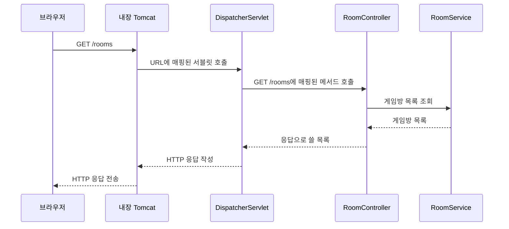

# 스프링 부트 웹 앱 학습 노트

> [!info] 관련 개념
> - [[#pom.xml만으로 무엇이 준비될까]] — 스타터, 부모 POM, Maven 플러그인의 역할
> - [[#Spring은 왜 객체를 관리할까]] — IoC, 생성자 주입, 컨테이너와 Bean
> - [[#컴포넌트 스캔과 자동 설정은 무엇이 다를까]] — 우리 코드 발견과 Boot 기본 구성
> - [[#main에서 왜 자기 클래스 정보를 넘길까]] — JVM의 진입점과 Spring의 설정 출발점
> - [[#Tomcat은 서블릿을 어떻게 실행할까]] — Servlet API, 서블릿 컨테이너, 웹 서버와 WAS
> - [[#GET /rooms는 어떻게 컨트롤러에 도착할까]] — `MainServlet`에서 `DispatcherServlet`로
> - [[#다른 컴퓨터에 배포해도 Tomcat을 쓸까]] — 접속 주소, 내장 Tomcat과 외장 Tomcat

**원본 대화**

- [기본 pom.xml 설명](chatgpt-conversation://6afb0b5b-cd28-83ec-b3d0-6403c2c82aa4)
- [기본 Application 코드 설명 1탄](chatgpt-conversation://6afb11c3-6230-83ee-beaf-e75331460f92)
- [기본 Application 코드 설명 2탄 Spring Boot 기본 구조 설명](chatgpt-conversation://6afc5ad6-a500-83e8-b9c9-1bfdc982041f)
- [서블릿 개념 설명](chatgpt-conversation://6afc6906-4790-83e8-8a8b-db65a3710e37)
- [서블릿 작동 원리](chatgpt-conversation://6afd932f-a1f8-83ec-8197-28acc533fcba)
- [톰캣 서버 사용 여부](chatgpt-conversation://6afda0d7-7cd8-83e8-8daa-0e5eeac4f68a)

대화에 나온 Yerdle 초기 프로젝트의 `pom.xml`과 `YerdleBackendApplication.java`에서 출발한다. 여기에 웹 기능을 추가해 게임방 목록 `GET /rooms`를 받는 상황을 가정하고, SSAFY의 `3logindao` 실습과 연결해 본다. Java·JDK·Maven·Spring의 역할부터 다시 보고 싶다면 [[01 · 자바·스프링 개발 학습 노트|자바·스프링 개발 학습 노트]]를 참고한다.

## pom.xml만으로 무엇이 준비될까

> 아무 dependency 추가 안한 pom.xml인데, 이게 기본인가요? 각각의 속성에 대해 알려주세요.

`pom.xml`은 Maven이 읽는 프로젝트 모델이다. 대화에서 Spring Initializr로 만든 예제는 Spring Boot `4.1.2`, Java `21`, 프로젝트 버전 `0.0.1-SNAPSHOT`을 사용한다. Initializr에서 추가 기능을 고르지 않은 상태에도 실행용 기본 스타터와 테스트용 스타터가 들어 있다. [Maven POM 참조](https://maven.apache.org/pom.html), [Spring Boot 스타터 목록](https://docs.spring.io/spring-boot/reference/using/build-systems.html#using.build-systems.starters)

| 선언 위치 | 예제의 항목 | Maven이 하는 일 |
| --- | --- | --- |
| `<parent>` | `spring-boot-starter-parent` | 의존성과 플러그인의 버전 관리, 빌드 기본값을 상속한다. |
| `<dependencies>` | `spring-boot-starter` | Spring Boot 핵심 라이브러리와 그 하위 의존성을 가져온다. |
| `<dependencies>` | `spring-boot-starter-test` | `test` 범위로 테스트 컴파일과 실행에 필요한 라이브러리를 가져온다. |
| `<build><plugins>` | `spring-boot-maven-plugin` | `spring-boot:run`으로 앱을 실행하고, 예제 설정에서는 `package` 중 실행 가능한 아카이브로 재패키징한다. |

> "앞서 살펴본 Maven의 pom.xml에 Spring Boot 관련 의존성이 있기 때문에 사용할 수 있는 것이죠."라고 했는데, spring-boot-starter 말하는 거죠?

그렇다. 예제에서 `spring-boot-starter`를 따라 Maven이 가져오는 JAR 가운데 `spring-boot`에 `SpringApplication`, `spring-boot-autoconfigure`에 `@SpringBootApplication`, Spring Framework의 `spring-context`에 `@Configuration`과 `@Bean`이 있다. Java의 `import`는 이미 클래스패스에 있는 타입을 짧은 이름으로 참조할 수 있게 한다. `import`에 쓴 라이브러리를 실제로 가져오는 일은 Maven이 맡는다. 태그별 의미와 의존성 확인 명령은 [[04 · Spring Boot의 pom.xml|Spring Boot의 pom.xml]]에서 볼 수 있다. [Spring Boot 4.1.2 기본 스타터 구성](https://github.com/spring-projects/spring-boot/blob/v4.1.2/starter/spring-boot-starter/build.gradle), [자동 설정 모듈 구성](https://github.com/spring-projects/spring-boot/blob/v4.1.2/core/spring-boot-autoconfigure/build.gradle), [Spring의 Java 기반 설정](https://docs.spring.io/spring-framework/reference/core/beans/java/basic-concepts.html)

## Spring은 왜 객체를 관리할까

> 기초부터 공부하는 입장에서 스프링부트에서 @Configuration과 @Bean에 대해서부터 설명해주면 좋겠습니다.

> 스프링 프레임워크의 핵심 설계 철학인 제어의 역전과 의존성 주입을 설명하고 이에 의거해서 Spring 컨테이너가 무엇이고 왜 필요한지 설명해주세요.

게임방을 만드는 `RoomService`가 방 코드 생성에 `RoomCodeGenerator`를 사용한다고 하자. `RoomService` 안에서 `new RoomCodeGenerator()`를 호출하면 서비스가 방 코드를 사용하는 일과 생성기 객체를 만드는 일을 함께 맡는다. 생성자로 받도록 바꾸면 호출자가 생성기 객체를 골라 넘길 수 있다. 앱에서 쓸 생성기와 테스트에서 쓸 생성기를 바꿔 끼울 자리도 생긴다.

```java
class RoomService {
    private final RoomCodeGenerator generator;

    RoomService(RoomCodeGenerator generator) {
        this.generator = generator;
    }
}
```

| 개념 | 이 예제에서 뜻하는 것 |
| --- | --- |
| DI(의존성 주입) | 필요한 생성기를 `RoomService` 생성자 인자로 전달한다. 일반 Java에서도 `new RoomService(new RoomCodeGenerator())`로 가능하다. |
| IoC(제어의 역전) | 서비스가 쓸 객체를 누가 만들고 연결할지에 대한 제어권이 서비스 밖으로 옮겨간다. DI는 객체 구성에서 IoC를 구현하는 방법이다. |
| Spring IoC 컨테이너 | `ApplicationContext`가 Bean 정의를 읽고, 객체를 생성하거나 공급받아 의존성을 연결하고 생명주기를 관리한다. |
| Bean | Spring 컨테이너가 관리하는 객체다. 기본 `singleton` 범위에서는 같은 컨테이너 안에서 Bean 정의 하나당 인스턴스 하나를 공유한다. |

서비스가 늘어 `RoomController`에 `RoomService`를, `RoomService`에 `RoomCodeGenerator`를 전달해야 한다면 컨테이너가 이 연결을 맡을 수 있다. 개발자는 어떤 객체를 관리할지 선언한다. 아래에서 `RoomBeanConfig`가 설정으로 등록되면 Spring은 `@Bean` 메서드를 읽고, `roomService`를 만들 때 필요한 `RoomCodeGenerator` Bean을 인자로 넘긴다. 기본 Bean 이름은 메서드 이름인 `roomCodeGenerator`와 `roomService`다. [Spring IoC와 Bean](https://docs.spring.io/spring-framework/reference/core/beans/introduction.html), [Spring의 Java 기반 설정](https://docs.spring.io/spring-framework/reference/core/beans/java/basic-concepts.html)

```java
import org.springframework.context.annotation.Bean;
import org.springframework.context.annotation.Configuration;

@Configuration
class RoomBeanConfig {
    @Bean
    RoomCodeGenerator roomCodeGenerator() {
        return new RoomCodeGenerator();
    }

    @Bean
    RoomService roomService(RoomCodeGenerator generator) {
        return new RoomService(generator);
    }
}
```

`@Configuration`은 이 클래스를 설정으로 읽도록 표시하고, `@Bean`은 표시된 메서드가 돌려준 객체를 Bean으로 관리하게 한다. 코드에서 `new`로 만든 객체도 이처럼 컨테이너에 공급하면 Bean이 된다. 앱 코드에서 직접 생성해 그 안에서만 쓰는 객체는 일반 Java 객체로 남는다.

객체를 직접 연결하는 Java 예시는 [[04 · IoC·DI와 Spring 컨테이너|IoC·DI와 Spring 컨테이너]], 설정 클래스에 Bean을 선언하고 관리하는 과정은 [[05 · Spring Bean과 자바 설정|Spring Bean과 자바 설정]]에서 이어서 볼 수 있다.

## 컴포넌트 스캔과 자동 설정은 무엇이 다를까

> 기본 Application.java 기본 코드에서 왜 굳이 ComponentScan을 하고, AutoConfiguration을 하는 거죠? 둘 다 패키지 내 다른 곳에서 해도 되는 거 아닌가요?

방 코드를 만드는 객체처럼 생성 방법을 직접 정하고 싶다면 `@Bean` 메서드를 쓸 수 있다. `RoomService`를 스캔으로 등록하려면 `RoomBeanConfig`의 `roomService()` 메서드를 빼고 `RoomService` 클래스에 `@Service`를 붙인다. `@ComponentScan`은 지정된 패키지에서 `@Component`, `@Service`, `@RestController` 같은 표시가 붙은 클래스를 찾아 Bean 정의를 등록한다. 컨테이너가 `RoomService`를 생성할 때 생성자가 요구하는 `RoomCodeGenerator`를 주입한다. 생성자가 하나면 Spring이 그 생성자를 사용하므로 `@Autowired`는 생략할 수 있다. [Spring 클래스패스 스캔과 컴포넌트](https://docs.spring.io/spring-framework/reference/core/beans/classpath-scanning.html), [Spring의 생성자 주입](https://docs.spring.io/spring-framework/reference/core/beans/annotation-config/autowired.html)

| 구성 | 하는 일 | Yerdle 예시 |
| --- | --- | --- |
| `@SpringBootConfiguration` | Spring의 `@Configuration`을 바탕으로 Boot 앱의 주요 설정 클래스를 표시한다. | 앱의 설정 클래스에 `@Bean`이나 `@Import`를 둘 수 있다. |
| `@ComponentScan` | 탐색 범위에서 애플리케이션의 컴포넌트를 발견한다. | `com.yerdle.backend` 하위의 `RoomService`와 `RoomController`를 찾는다. |
| `@EnableAutoConfiguration` | Boot가 제공하는 설정 후보 중 클래스패스, 기존 Bean, 설정값 등 조건에 맞는 구성을 적용한다. | 서블릿 웹 앱에서 라이브러리와 조건이 갖춰지면 내장 서버와 Spring MVC의 기본 구성을 준비한다. |

`@SpringBootApplication`은 이 세 기능을 묶는다. 기본 스캔 범위는 이 애너테이션을 붙인 클래스의 패키지와 하위 패키지다. `com.yerdle.backend`에 두면 `com.yerdle.backend.room`과 `com.yerdle.backend.user`를 함께 탐색한다. 다른 클래스에서 선언할 때는 그 클래스가 설정 소스로 등록되거나 `@Import` 등으로 실제 컨텍스트에 포함되어야 한다. 하위 패키지로 옮기면 기본 탐색 범위도 달라진다. `@EnableAutoConfiguration`이 잡는 기본 패키지는 JPA 엔티티 같은 대상을 찾는 데도 쓰일 수 있어, 보통 앱의 최상위 패키지에서 자동 설정을 한 번 켠다. [Spring Boot의 기본 애너테이션](https://docs.spring.io/spring-boot/reference/using/using-the-springbootapplication-annotation.html), [패키지 구조](https://docs.spring.io/spring-boot/reference/using/structuring-your-code.html), [자동 설정과 기본 패키지](https://docs.spring.io/spring-boot/reference/using/auto-configuration.html)

대화의 Boot `4.1.2` 예제에 `spring-boot-starter-webmvc`를 추가하면 Maven이 Spring MVC와 기본 내장 Tomcat 관련 라이브러리를 가져온다. 앱 시작 시 Boot가 이 클래스패스와 앱 종류 등을 보고 웹 설정을 적용한다. 자동 설정마다 조건이 다르고, 특정 Bean을 직접 등록하면 해당 기본 Bean을 물리는 조건도 있다. 어떤 설정이 적용됐는지 궁금할 때는 앱 인자 `--debug`로 조건 평가 보고서를 확인할 수 있다. [Spring Boot의 첫 웹 앱 예제](https://docs.spring.io/spring-boot/tutorial/first-application/index.html), [자동 설정 조건 확인](https://docs.spring.io/spring-boot/reference/using/auto-configuration.html)

패키지를 옮길 때 어떤 클래스가 발견되는지는 [[06 · 컴포넌트 스캔|컴포넌트 스캔]], 내장 서버 구성이 적용되는 조건과 확인 방법은 [[07 · Spring Boot 자동 설정|Spring Boot 자동 설정]]에서 다룬다.

## main에서 왜 자기 클래스 정보를 넘길까

> 아니 근데 뭔가 Application 클래스 내의 main 함수의 스프링 애플리케이션 실행을 위해 Application 클래스를 넘긴다는 게 뭔가 이상해 보여요

```java
package com.yerdle.backend;

import org.springframework.boot.SpringApplication;
import org.springframework.boot.autoconfigure.SpringBootApplication;

@SpringBootApplication
public class YerdleBackendApplication {
    public static void main(String[] args) {
        SpringApplication.run(YerdleBackendApplication.class, args);
    }
}
```

| 코드 | 맡는 역할 |
| --- | --- |
| `package com.yerdle.backend` | 클래스 소속을 지정한다. 여기서는 기본 컴포넌트 스캔의 출발점이기도 하다. |
| `public static void main(String[] args)` | JVM이 호출하는 Java 프로그램의 진입점이다. `static` 메서드이므로 인스턴스를 만들지 않고 호출한다. |
| `YerdleBackendApplication.class` | 해당 타입을 나타내는 `Class<YerdleBackendApplication>` 객체다. Boot는 이 객체가 가리키는 클래스에서 설정을 읽는다. |
| `SpringApplication.run(..., args)` | Boot가 제공하는 시작 메서드다. 설정 소스와 명령행 인자를 받아 초기화된 `ConfigurableApplicationContext`를 반환한다. |

JVM이 `main()`을 호출하면, `main()` 본문은 Boot에 설정 클래스의 정보를 건넨다. `.class`를 평가해 인자로 넘기는 과정에서는 `main()`을 다시 호출하지 않는다. 기본 코드는 Java 진입점과 Spring 설정의 출발점을 `YerdleBackendApplication` 한 곳에 둔다. [SpringApplication API](https://docs.spring.io/spring-boot/api/java/org/springframework/boot/SpringApplication.html)

두 역할을 나눠 보면 첫 번째 인자의 의미가 드러난다. 아래는 같은 패키지에서 선언을 나눈 예시다. 이제도 JVM이 호출하는 것은 `YerdleBackendApplication.main()`이고, Spring이 설정으로 읽는 클래스는 `AppConfig`다. [Spring Boot의 애너테이션 구성](https://docs.spring.io/spring-boot/reference/using/using-the-springbootapplication-annotation.html)

```java
package com.yerdle.backend;

import org.springframework.boot.SpringApplication;
import org.springframework.boot.SpringBootConfiguration;
import org.springframework.boot.autoconfigure.EnableAutoConfiguration;
import org.springframework.context.annotation.ComponentScan;

@SpringBootConfiguration
@EnableAutoConfiguration
@ComponentScan
class AppConfig {
}

public class YerdleBackendApplication {
    public static void main(String[] args) {
        SpringApplication.run(AppConfig.class, args);
    }
}
```

`run()`은 실행 인자와 환경 설정을 준비하고 앱에 맞는 컨텍스트를 만든다. 컨텍스트 초기화 과정에서 설정 클래스, 컴포넌트 스캔, 자동 설정을 처리해 Bean을 등록하고 필요한 객체를 생성·연결한다. 내장 서버를 쓰는 서블릿 웹 앱이라면 이 시작 과정에서 서버도 뜬다. 대화의 초기 POM은 기본 스타터만으로도 Spring을 시작할 수 있다. 웹 서버가 뜰 구성과 JVM을 계속 실행할 다른 작업이 없으면 초기화를 마친 뒤 프로세스가 정상 종료될 수 있다. [SpringApplication API](https://docs.spring.io/spring-boot/api/java/org/springframework/boot/SpringApplication.html), [Spring Boot 내장 웹 서버](https://docs.spring.io/spring-boot/how-to/webserver.html)

`main()`과 설정 클래스를 나눈 예시에서 실행 인자와 컨텍스트의 역할은 [[08 · SpringApplication과 시작 클래스|SpringApplication과 시작 클래스]]에서 확인할 수 있다.

## Tomcat은 서블릿을 어떻게 실행할까

> 서블릿, 서블릿 컨테이너는 뭔가요? 스프링에서는 몰라도 되는 내용인가요?

> 웹서버와 WAS는 뭔가요? 톰캣은 웹서버인가요, WAS인가요?

웹 프로그램이 HTTP 요청을 처리하려면 연결을 받고 요청 메시지를 해석해 Java 코드에 전달해야 한다. 서블릿 기반 앱에서는 이 반복 작업을 실행 환경이 맡고, 앱 코드는 표준 API를 통해 요청과 응답에 접근한다.

| 개념 | 맡는 역할 |
| --- | --- |
| Jakarta Servlet API | 컨테이너와 애플리케이션이 함께 따르는 규격이다. `HttpServlet`, `HttpServletRequest`, `HttpServletResponse` 같은 자바 타입을 제공한다. |
| 서블릿 | 컨테이너가 호출하는 요청 처리 객체다. `HttpServlet`의 `doGet()` 등을 재정의해 HTTP 메서드별 동작을 작성할 수 있다. |
| 서블릿 컨테이너 | 서블릿을 등록하고 URL에 따라 찾아 호출한다. 생성, 초기화, 요청 처리, 종료를 관리하고 요청·응답 객체를 전달한다. |
| 웹 서버 | HTTP 요청을 받아 응답을 보내는 서버 소프트웨어다. 정적 파일을 제공하거나 요청을 다른 서버에 전달할 수도 있다. |
| WAS(Web Application Server) | 요청을 처리할 웹 애플리케이션 코드를 실행하는 서버를 가리킨다. Tomcat은 HTTP 서버 기능과 서블릿 컨테이너 기능을 모두 제공해 Java 웹 개발에서 WAS라고도 부른다. |

정적 파일을 제공하는 기능은 Tomcat에도 있다. 서블릿 컨테이너의 고유한 역할은 서블릿 규격에 따라 Java 웹 코드를 실행하는 것이다. 다른 호환 컨테이너도 같은 규격의 서블릿을 실행할 수 있다. Java 웹 개발에는 Servlet 기반과 함께 Reactor Netty를 사용하는 WebFlux 같은 방식도 있다. [Jakarta Servlet 명세](https://jakarta.ee/specifications/servlet/6.1/jakarta-servlet-spec-6.1.html), [Apache Tomcat이 구현하는 명세](https://tomcat.apache.org/whichversion.html), [Spring Boot 내장 웹 서버](https://docs.spring.io/spring-boot/how-to/webserver.html)

`3logindao`에는 `HttpServlet`을 상속한 `MainServlet`과 컴파일에 쓰는 `jakarta.servlet-api` 의존성이 있다. 앱은 WAR 형태로 배포할 수 있고, Eclipse에서 `Run on Server`로 별도 Tomcat을 선택하면 IDE가 앱을 게시하고 서버를 시작할 수 있다. 개발자는 `MainServlet`에 요청을 처리할 코드를 작성하고, 서블릿의 생성과 `service()` 호출은 앱을 배포받은 Tomcat이 맡는다. 이 구조에서도 실행을 컨테이너가 제어한다는 의미의 IoC를 볼 수 있다. `init()`은 첫 요청을 처리하기 전에 호출되며, 같은 인스턴스의 `service()`가 여러 요청을 동시에 처리할 수 있다. [Jakarta Servlet 생명주기](https://jakarta.ee/specifications/servlet/6.1/jakarta-servlet-spec-6.1.html#servlet-life-cycle)

앞단 웹 서버와 Tomcat의 역할은 [[02 · 웹 서버와 WAS|웹 서버와 WAS]], 서블릿의 등록과 생명주기는 [[03 · 서블릿과 서블릿 컨테이너|서블릿과 서블릿 컨테이너]]에서 더 자세히 다룬다.

## GET /rooms는 어떻게 컨트롤러에 도착할까

> 그리고 여기서도 결국 스프링MVC의 DispatcherServlet처럼 서블릿이 하나인 거 아냐?

SSAFY 실습에서 `GET /logindao/main?action=list`를 보내면 Tomcat이 `/logindao` 앱의 `/main` 매핑으로 `MainServlet`을 선택한다. 상속한 `HttpServlet.service()`가 GET 요청을 `doGet()`으로 넘기고, `MainServlet`의 `switch (action)`이 목록 처리 메서드를 고른다. 여러 기능의 요청을 한 진입점에 모아 분배하는 **프론트 컨트롤러 패턴**이다. 기능마다 별도 서블릿을 둘 수도 있으며, 실습에서 `MainServlet` 하나라는 말은 직접 작성한 요청 처리용 서블릿을 센 것이다. 세부 코드는 [[01 · MainServlet과 DispatcherServlet|MainServlet과 DispatcherServlet]]에서 확인할 수 있다. [Jakarta Servlet 요청 처리와 URL 매핑](https://jakarta.ee/specifications/servlet/6.1/jakarta-servlet-spec-6.1.html)

Spring MVC에서는 프론트 컨트롤러가 `DispatcherServlet`이다. Tomcat이 먼저 서블릿을 선택하고, `DispatcherServlet`이 Spring MVC의 `HandlerMapping`을 이용해 `GET /rooms`에 맞는 `RoomController` 메서드를 찾는다. `HandlerAdapter`가 해당 메서드의 호출을 맡는다. `@RestController`의 메서드가 목록을 반환하면, Spring MVC는 메시지 변환기를 사용해 목록을 JSON 같은 응답 본문으로 쓴다. [Spring MVC의 DispatcherServlet](https://docs.spring.io/spring-framework/reference/web/webmvc/mvc-servlet.html), [Spring MVC의 응답 본문 처리](https://docs.spring.io/spring-framework/reference/web/webmvc/mvc-controller/ann-methods/responsebody.html)



Spring MVC 개발에서는 보통 컨트롤러의 매핑과 업무 코드부터 작성한다. 요청이 아예 서버에 도착하지 않은 경우와, 서버에는 도착했지만 MVC가 맞는 핸들러를 찾지 못한 경우를 구분하려면 이 두 단계의 매핑을 기억해 두면 된다.

상품 목록 예시에서 데이터와 화면, 요청 처리의 책임은 [[04 · MVC|MVC]]에서, 여러 요청을 한 진입점에서 분배하는 설계는 [[05 · 프론트 컨트롤러 패턴|프론트 컨트롤러 패턴]]에서 이어서 볼 수 있다.

## 다른 컴퓨터에 배포해도 Tomcat을 쓸까

> 톰캣 "서버"라고 하는데, 만약 제가 만든 프로그램을 localhost가 아닌 외부의 다른 컴퓨터와 인터넷으로 통신할 때도 톰캣 서버를 쓰나요? 개발 컴퓨터가 아닌 다른 서버 컴퓨터에 배포할 때도 톰캣 서버를 쓰나요?

세 환경에서 모두 Tomcat을 쓸 수 있다. 서버 컴퓨터는 Java 프로세스가 실행되는 물리·가상 컴퓨터이고, Tomcat은 그 컴퓨터에서 HTTP 요청을 받는 서버 프로그램이다. `localhost`는 접속하는 브라우저가 실행 중인 컴퓨터 자신의 주소다. 친구가 자기 PC에서 `localhost:8080`을 열면 친구 PC를 찾는다. [RFC 6761의 localhost 정의](https://www.rfc-editor.org/rfc/rfc6761.html#section-6.3)

| 어디에서 접속하나 | 브라우저가 사용하는 주소 | Tomcat이 실행되는 곳 |
| --- | --- | --- |
| 내 개발 컴퓨터 | `http://localhost:8080` | 같은 컴퓨터 |
| 같은 네트워크의 다른 컴퓨터 | 예를 들어 `http://192.168.0.10:8080` | 개발 컴퓨터. 해당 네트워크 주소에서 요청을 받고 방화벽이 연결을 허용해야 한다. |
| 인터넷의 사용자 | 예를 들어 `https://api.example.com` | 배포한 서버 컴퓨터. 도메인, 네트워크 경로, 방화벽 및 앞단 프록시 등이 접속을 좌우한다. |

**추가 설명**　내 앱이 다른 서비스의 HTTP API를 호출할 때는 Java의 `HttpClient` 같은 클라이언트가 요청을 보낸다. 이 경우 Tomcat이 맡는 쪽은 내 앱으로 들어오는 요청이다. [Java HttpClient API](https://docs.oracle.com/en/java/javase/21/docs/api/java.net.http/java/net/http/HttpClient.html)

| 배포 방식 | 무엇을 실행하나 | Tomcat은 어디에서 오나 |
| --- | --- | --- |
| 실행 가능한 Boot JAR와 내장 Tomcat | Java 환경에서 `java -jar app.jar`로 앱을 실행한다. | 앱에 포함된 라이브러리다. Boot가 같은 JVM에서 서버를 시작한다. |
| WAR와 외장 Tomcat | 별도로 설치한 Tomcat에 호환되는 WAR를 배포한다. Eclipse는 개발 중 WAR를 풀어 놓은 형태로 게시할 수도 있다. | 배포 환경에 준비된 서버 프로그램이 앱을 로딩한다. |

Spring Boot도 서블릿 웹 앱을 WAR로 구성해 외장 Tomcat에 배포할 수 있다. 내장과 외장은 서버를 함께 패키징하고 누가 시작하느냐의 차이다. 실행 가능한 JAR를 다른 서버에 옮기거나 Docker에서 실행하는 경우에도, 내장 Tomcat을 포함한 빌드라면 Boot가 그 실행 환경에서 Tomcat을 시작한다. [Spring Boot 실행 가능한 패키징](https://docs.spring.io/spring-boot/maven-plugin/packaging.html), [Spring Boot의 외장 컨테이너 배포](https://docs.spring.io/spring-boot/how-to/deployment/traditional-deployment.html)

접속 위치별 주소와 내장·외장 방식의 실행 주체는 [[06 · Tomcat과 배포|Tomcat과 배포]]에서 비교한다.

## 복습 질문

- `spring-boot-starter-parent`, `spring-boot-starter`, `spring-boot-maven-plugin`은 각각 언제 무엇에 쓰일까?
- `RoomService`가 생성기로 `RoomCodeGenerator`를 전달받는 구조에서 DI는 어떻게 이루어질까? 객체를 직접 연결할 때와 컨테이너에 맡길 때 생성 코드의 위치는 어떻게 달라질까?
- `@Service`가 붙은 `RoomService`와 내장 서버의 기본 설정은 각각 어떤 기능으로 컨텍스트에 들어올까? 앱 설정 클래스를 `room` 하위 패키지로 옮기면 무엇을 확인해야 할까?
- JVM이 실행하는 `main()`과 `SpringApplication.run()`에 전달하는 `.class`는 어떤 역할일까? 기본 POM으로 실행했을 때 HTTP 서버가 뜨려면 무엇이 더 필요할까?
- `GET /logindao/main?action=list`에서 Tomcat과 `MainServlet`은 각각 무엇으로 처리 대상을 고를까? `GET /rooms`에서는 그 역할을 누가 맡을까?
- 친구 PC에서 `localhost:8080`에 접속하면 어디를 가리킬까? 실행 가능한 Boot JAR를 서버에 옮기면 Tomcat은 누가 시작할까?
