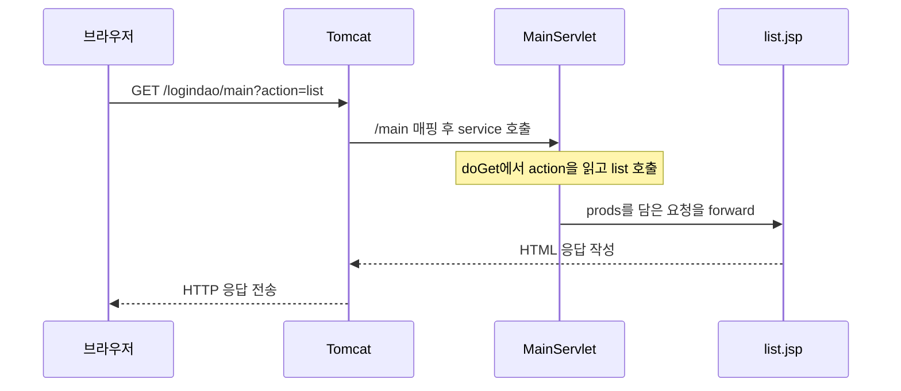

# MainServlet과 DispatcherServlet

[원본 대화 · 서블릿 개념 설명](chatgpt-conversation://6afc6906-4790-83e8-8a8b-db65a3710e37) · [원본 대화 · 서블릿 작동 원리](chatgpt-conversation://6afd932f-a1f8-83ec-8197-28acc533fcba)

SSAFY 실습의 상품 목록 요청 하나를 따라가며 Tomcat과 서블릿이 하는 일을 살펴본다. 실습 코드는 로컬의 `C:\SSAFY\workspace\05back\3logindao`에서 확인했다. Spring Boot 웹 앱이 시작되고 배포되는 전체 흐름은 [[02 · 스프링 부트 웹 앱 학습 노트|스프링 부트 웹 앱 학습 노트]]에서 볼 수 있다.

## Tomcat은 어떻게 MainServlet을 찾을까?

> 나는 톰캣을 쓰겠다고 선언한 적도 없는데 어떻게 서블릿 컨테이너이자 WAS인 톰캣이 외부 요청에 따라 내가 만든 서블릿이 작동하는 거지?

`3logindao`의 `pom.xml`에서 `<packaging>war</packaging>`은 Maven에 서블릿 컨테이너에 배포할 웹 애플리케이션을 WAR 형식으로 묶으라고 지정한다. `jakarta.servlet-api`는 `HttpServlet`과 같은 표준 타입을 제공한다. 실제 실행 환경은 별도로 구성한다. Eclipse에서 **Run on Server**를 실행하면 선택한 서버에 웹 앱을 배포한다. 아래 예시는 이 앱을 로컬의 `8080` 포트를 쓰는 Tomcat에 배포한 상황이다.

Tomcat은 배포 시 `@WebServlet`이나 `WEB-INF/web.xml`의 서블릿 선언과 URL 매핑을 읽어 등록할 수 있다. 이 실습의 `web.xml`에는 시작 페이지 후보가 들어 있고, `/main` 매핑은 `MainServlet`의 `@WebServlet("/main")`에서 온다. Eclipse의 웹 프로젝트 설정에 들어 있는 `logindao`가 컨텍스트 경로에 해당한다. [Jakarta Servlet 규격 §8과 §12](https://jakarta.ee/specifications/servlet/6.1/jakarta-servlet-spec-6.1)

브라우저에서 `http://localhost:8080/logindao/main?action=list`로 접근할 때 URL의 각 부분은 아래처럼 쓰인다.

| URL 부분 | 쓰이는 곳 |
| --- | --- |
| `localhost:8080` | 브라우저가 현재 컴퓨터의 8080번 포트에 연결한다. |
| `/logindao` | Tomcat이 이 경로에 배포된 웹 애플리케이션을 선택한다. |
| `/main` | Tomcat이 웹 애플리케이션 안의 URL 매핑으로 `MainServlet`을 선택한다. |
| `?action=list` | `MainServlet`이 요청 파라미터에서 `action`의 값 `list`를 읽어 목록 처리 메서드를 선택한다. |

## 상품 목록 링크를 클릭하면 어떤 메서드가 호출될까?

`index.jsp`에서 목록 링크를 누르면 브라우저가 `GET /logindao/main?action=list`를 보낸다. Tomcat은 서블릿에 `HttpServletRequest`와 `HttpServletResponse` 객체를 넘긴다. 요청 객체에서는 HTTP 메서드, 헤더, 파라미터 등의 정보를 읽을 수 있다. 응답 객체에는 상태 코드와 헤더를 설정하거나 본문을 쓸 수 있다. [Jakarta Servlet 규격 §2.3.3](https://jakarta.ee/specifications/servlet/6.1/jakarta-servlet-spec-6.1)

`MainServlet`이 상속한 `HttpServlet`의 `service()`가 HTTP 메서드를 보고 GET이면 `doGet()`을 호출한다. `doGet()`은 `request.getParameter("action")`을 읽고 `switch`에서 `list(request, response)`를 선택한다. `list()`는 상품 목록을 조회해 요청 속성 `prods`에 담고 같은 요청을 `/list.jsp`로 전달한다. JSP는 `prods`로 HTML을 만들고, Tomcat이 응답을 브라우저로 전송한다. [Jakarta Servlet 규격 §2.1과 §9.4](https://jakarta.ee/specifications/servlet/6.1/jakarta-servlet-spec-6.1)

## 서블릿 객체는 요청마다 생성될까?

Tomcat이 서블릿 객체를 만들고, 초기화와 요청 처리, 종료 시점에 정해진 메서드를 호출한다. 개발자는 호출될 코드를 작성하고 호출 시점은 컨테이너가 결정한다는 점에서 앞서 배운 제어의 역전(IoC)과 연결된다. [Jakarta Servlet 규격 §2.2와 §2.3](https://jakarta.ee/specifications/servlet/6.1/jakarta-servlet-spec-6.1)

| 메서드 | 호출 시점 |
| --- | --- |
| `init()` | 서블릿 인스턴스를 만든 뒤, 요청을 받기 전에 한 번 초기화한다. 생성 시점은 설정에 따라 앱이 시작될 때나 요청 처리에 처음 필요할 때가 될 수 있다. |
| `service()` | 컨테이너가 서블릿에 요청을 전달할 때 호출한다. HTTP 요청은 이 메서드를 거쳐 `doGet()`, `doPost()` 등으로 연결된다. |
| `destroy()` | 애플리케이션이 내려가는 등 사용 중인 서블릿을 서비스에서 제거할 때 정리 작업을 할 수 있도록 호출한다. |

보통 같은 서블릿 인스턴스가 여러 요청을 처리하며, 서로 다른 스레드가 해당 인스턴스의 메서드를 동시에 실행할 수 있다. 예를 들어 사용자별 `action`을 인스턴스 필드에 저장하면 두 요청이 서로의 값을 덮어쓸 수 있다. 실습에서 `action`은 `doGet()`의 지역 변수이고, `prods`는 현재 요청의 속성이므로 이 데이터는 요청별로 유지된다.

## MainServlet과 DispatcherServlet은 어떻게 요청을 나눌까?

> 그리고 여기서도 결국 스프링MVC의 DispatcherServlet처럼 서블릿이 하나인 거 아냐?

서블릿은 `/login`, `/list`처럼 기능별 URL에 여럿 등록할 수 있다. `3logindao`는 개발자가 작성한 요청 진입점을 `MainServlet` 하나에 두고, 목록·로그인·등록을 `action` 값으로 나눈다. 여러 요청이 하나의 진입점을 거친 뒤 기능별 코드로 분배되는 구조를 **프론트 컨트롤러 패턴**이라고 한다. 이 구성에서도 JSP는 서블릿으로 변환되어 실행될 수 있다. Spring MVC는 같은 패턴을 구현한 `DispatcherServlet`과 요청을 분배하는 구성 요소를 제공한다. [Spring Framework의 DispatcherServlet 문서](https://docs.spring.io/spring-framework/reference/web/webmvc/mvc-servlet.html)

| 역할 | `3logindao` | Spring MVC |
| --- | --- | --- |
| 여러 요청을 받는 서블릿 | 개발자가 작성한 `MainServlet` | 프레임워크가 제공하는 `DispatcherServlet` |
| 기능 선택 | `switch(action)`이 값에 맞는 분기 선택 | `HandlerMapping`이 URL과 HTTP 메서드 등의 조건으로 처리할 컨트롤러 메서드 탐색 |
| 처리 코드 호출 | 분기에서 `list()` 등을 직접 호출 | `HandlerAdapter`가 파라미터 등을 준비해 컨트롤러 메서드 호출 |
| 상품 목록과 화면 연결 | 요청 속성에 목록을 담아 JSP로 전달 | 컨트롤러가 모델에 목록을 담고 뷰 이름을 반환하면 Spring MVC가 뷰를 찾아 렌더링하는 방식 등을 사용 |

Tomcat은 먼저 URL에 맞춰 서블릿을 고른다. Spring MVC가 처리하는 요청은 그다음 `DispatcherServlet`에서 다시 매핑된다. 예를 들어 `GET /rooms`라면 `HandlerMapping`이 `@GetMapping("/rooms")`에 연결된 메서드를 찾고 `HandlerAdapter`가 호출을 맡는다. [Spring Framework의 특수 빈 문서](https://docs.spring.io/spring-framework/reference/web/webmvc/mvc-servlet/special-bean-types.html)

상품 목록 요청이 모델과 화면으로 나뉘는 과정은 [[04 · MVC|MVC]], 두 서블릿이 요청을 한곳에서 받아 분배하는 이유는 [[05 · 프론트 컨트롤러 패턴|프론트 컨트롤러 패턴]]에서 설명한다.

## 복습 질문

- `/logindao/main?action=list`에서 웹 앱, 서블릿, 내부 처리 메서드를 선택하는 데 각각 어느 부분이 쓰일까?
- 브라우저가 보낸 GET 요청은 어떻게 `doGet()`을 거쳐 `list()`까지 도달할까? JSP는 목록 데이터를 어디서 꺼낼까?
- 사용자별 `action`을 서블릿 필드에 두면 두 요청이 동시에 들어올 때 어떤 일이 생길까?
- `switch(action)`과 직접 메서드를 호출하는 역할은 Spring MVC에서 각각 어떤 구성 요소가 맡을까?
